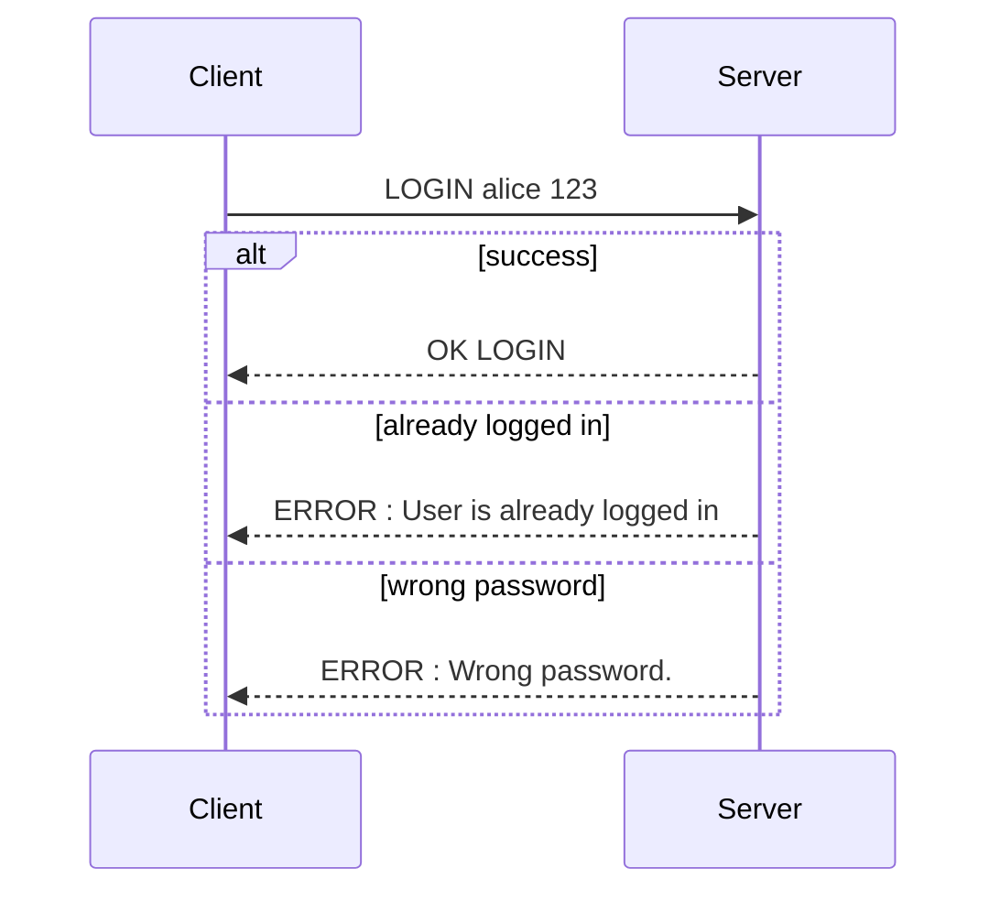
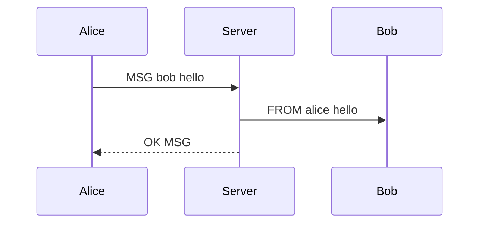
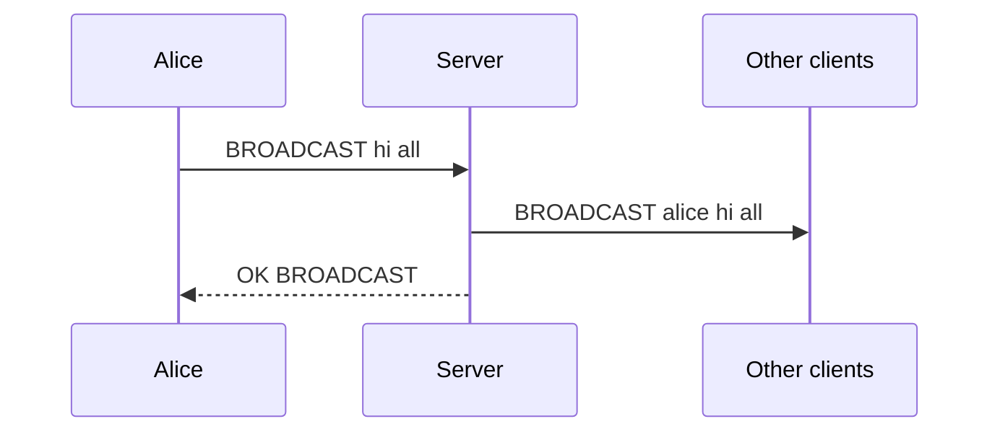
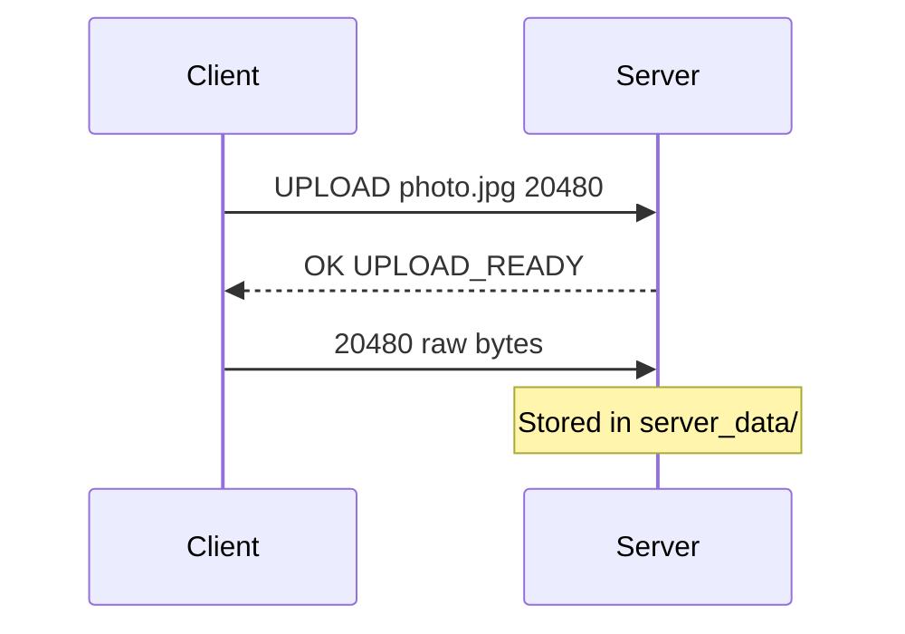
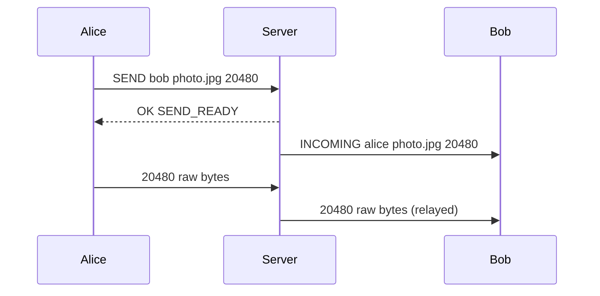

# Application-Layer Protocol Specification

## 1. Overview

A custom application-layer protocol over TCP. Control messages are newline-terminated text; file transfers use explicitly declared byte sizes so binary data can safely follow text commands on the same stream.

## 2. Message Format

- Encoding: UTF-8 text
- Delimiter: arguments are separated by single spaces
- Terminator: every control message ends with `\n`
- Case: commands are uppercase (e.g. `LOGIN`); arguments are case-sensitive

## 3. Sequence Diagrams

### 3.1 Authentication



### 3.2 Private Messaging



### 3.3 Broadcast



### 3.4 File Upload



### 3.5 Peer-to-Peer File Send (relayed)



## 4. Client → Server Commands

| # | Command | Purpose | Server response |
|---|---|---|---|
| 1 | `LOGIN username password` | Authenticate | `OK LOGIN` or an `ERROR` |
| 2 | `MSG target_user message` | Private message | `OK MSG` or `ERROR : User not found` |
| 3 | `BROADCAST message` | Message all other clients | `OK BROADCAST` |
| 4 | `LIST` | List active users | Usernames, one per line (*) |
| 5 | `UPLOAD filename filesize` | Store a file on the server | `OK UPLOAD_READY`, then client sends `filesize` raw bytes |
| 6 | `DOWNLOAD filename` | Retrieve a file | `FILE filename filesize`, then `filesize` raw bytes; or `ERROR : File not found` |
| 7 | `SEND target_user filename filesize` | Send a file to another client via the server | `OK SEND_READY`, then client sends `filesize` raw bytes |
| 8 | `LOGOUT` | Disconnect | None; connection closes |

(*) The original design called for `LIST_RESULT count` followed by usernames; the current implementation returns the usernames only.

## 5. Server → Client Asynchronous Messages

Handled by the client's background listener thread; may arrive at any time.

| Message | Meaning |
|---|---|
| `FROM sender message` | Incoming private message |
| `BROADCAST sender message` | Incoming broadcast |
| `FILE filename filesize` | Server is about to stream `filesize` bytes (response to `DOWNLOAD`) |
| `INCOMING sender filename filesize` | Another user is sending a file; client must read `filesize` raw bytes |

## 6. Error Messages

```
ERROR : User is already logged in
ERROR : Wrong password.
ERROR : Please login first
ERROR : User not found
ERROR : File not found
```
