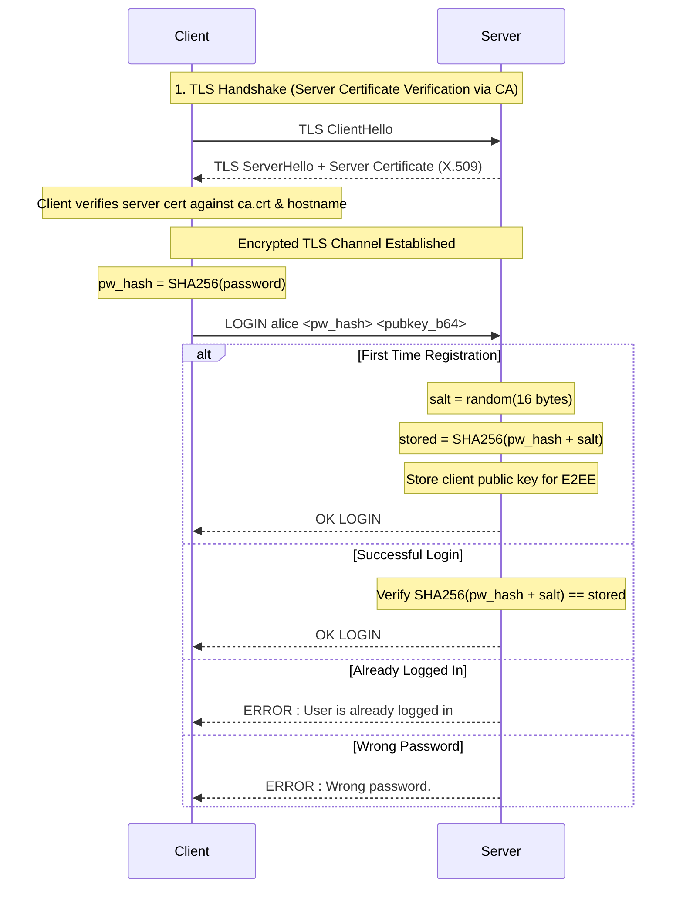
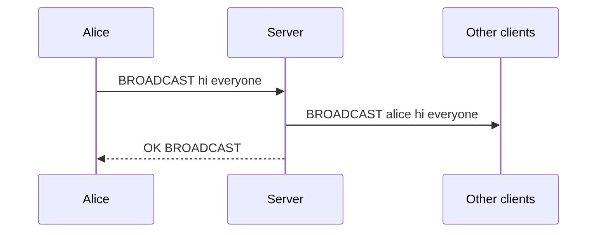
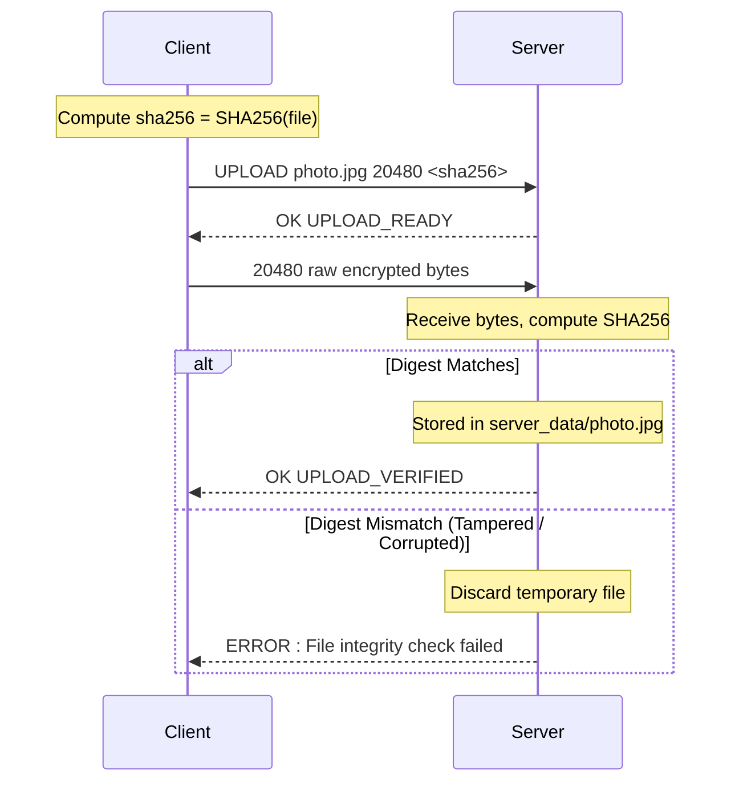
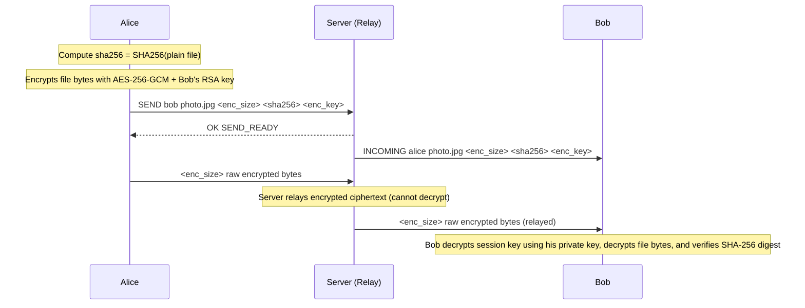

# Secure Application-Layer Protocol Specification

## 1. Overview

A secure application-layer protocol built over TLS-encrypted TCP sockets (`socket` + `ssl`).
- **Transport Security:** All control and binary data are encrypted at the transport layer using TLS 1.3/1.2 with X.509 certificate validation.
- **End-to-End Encryption (E2EE):** Private messages (`MSG`) and relayed peer-to-peer file transfers (`SEND`) are encrypted end-to-end between clients using hybrid RSA-2048 + AES-256-GCM. The server serves purely as a relay and cannot decrypt or inspect private messages or files.
- **Authentication:** Passwords are pre-hashed client-side (SHA-256) prior to transmission, and salted and stored securely on the server.
- **Framing:** Control messages are newline-terminated UTF-8 text lines. Binary transfers explicitly state byte lengths and SHA-256 digests in headers to ensure cryptographic integrity.

## 2. Message Format

- **Encoding:** UTF-8 text
- **Delimiter:** Arguments separated by single spaces
- **Terminator:** Control messages end with `\n`
- **Case:** Commands are uppercase (e.g. `LOGIN`, `UPLOAD`); arguments are case-sensitive

## 3. Protocol Sequence Diagrams

### 3.1 TLS Handshake & Authentication



### 3.2 Private Messaging (End-to-End Encrypted)

```mermaid
sequenceDiagram
    participant A as Alice
    participant S as Server (Relay)
    participant B as Bob
    Note over A,S: TLS Encrypted Transport
    Note over S,B: TLS Encrypted Transport
    Note over A: Alice fetches Bob's public key (GETKEY bob)
    Note over A: Encrypts msg with AES-256-GCM + Bob's RSA key
    A->>S: MSG bob <enc_key> <enc_msg>
    Note over S: Server cannot decrypt; only relays ciphertext!
    S->>B: FROM alice <enc_key> <enc_msg>
    S-->>A: OK MSG
    Note over B: Bob decrypts <enc_key> with his private key, then decrypts message
```

### 3.3 Broadcast



### 3.4 File Upload with SHA-256 Integrity Verification



### 3.5 Peer-to-Peer Relayed File Transfer (End-to-End Encrypted)



## 4. Client → Server Commands

| # | Command | Format | Server Response |
|---|---|---|---|
| 1 | `LOGIN` | `LOGIN <username> <client_pw_hash> <pubkey_b64>` | `OK LOGIN` or `ERROR : ...` |
| 2 | `GETKEY` | `GETKEY <target_user>` | `KEY <target_user> <pubkey_b64>` or `ERROR : User not found` |
| 3 | `MSG` | `MSG <target_user> <enc_key_b64> <enc_msg_b64>` | `OK MSG` or `ERROR : User not found` (Relayed E2EE) |
| 4 | `BROADCAST` | `BROADCAST <message>` | `OK BROADCAST` |
| 5 | `LIST` | `LIST` | Newline-separated list of active usernames |
| 6 | `UPLOAD` | `UPLOAD <filename> <filesize> <sha256>` | `OK UPLOAD_READY`, then client streams bytes. Server verifies digest and sends `OK UPLOAD_VERIFIED` or `ERROR : File integrity check failed` |
| 7 | `DOWNLOAD` | `DOWNLOAD <filename>` | `FILE <filename> <filesize> <sha256>` followed by raw bytes; or `ERROR : File not found` |
| 8 | `SEND` | `SEND <target_user> <filename> <enc_size> <sha256> <enc_key_b64>` | `OK SEND_READY`, then sender streams bytes; server relays to target (Relayed E2EE) |
| 9 | `LOGOUT` | `LOGOUT` | Connection terminates gracefully |

## 5. Server → Client Asynchronous Messages

Handled by the client background listener thread:

| Message | Format | Description |
|---|---|---|
| `KEY` | `KEY <user> <pubkey_b64>` | Response containing target user's RSA public key |
| `FROM` | `FROM <sender> <enc_key_b64> <enc_msg_b64>` | Incoming private chat (client decrypts using private key) |
| `BROADCAST` | `BROADCAST <sender> <message>` | Incoming broadcast message |
| `FILE` | `FILE <filename> <filesize> <sha256>` | Server streaming `<filesize>` bytes for download; client verifies digest upon reception |
| `INCOMING` | `INCOMING <sender> <filename> <enc_size> <sha256> <enc_key_b64>` | Incoming E2EE file relayed by server; client decrypts bytes and verifies digest |

## 6. Error Messages

```
ERROR : User is already logged in
ERROR : Wrong password.
ERROR : Please login first
ERROR : User not found
ERROR : File not found
ERROR : File integrity check failed
```
